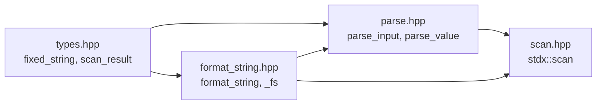

# cpp-middle-project2: documentation

A header-only C++23 library that does the reverse of `std::format` at compile time. `stdx::scan<fmt, source, Ts...>()` takes a format string and a source string as template arguments and gives back typed values usable in `static_assert`. A bad format string or a value that does not parse stops the build. It began as the sprint 2 project of the Yandex Practicum "Middle C++ developer" course (`README.md`). The code does not say who uses it beyond the course; see [open questions in SPEC.md](../SPEC.md#9-open-questions).

## Status

- Last commit to the library (`include/`): `0133640`, 2026-11-07 (`git log -- include`). Last commit to tests or build files: `88b56e5`, 2026-11-07.
- Tests: `tests/main.cpp`, 7 `tests/true_*.cpp` and 7 `tests/fail_*.cpp`, all registered with CTest in `CMakeLists.txt`.
- CI: Gitea workflows under `.gitea/workflows/` (lab standard, `runs-on: windows`). No GitHub Actions workflow is in the tree.
- Unfinished, as the files show:
  - `tests/main.cpp:170-222`: cases 8-12 are commented out and only print `[OK]`. The real checks are in `tests/fail_*.cpp`.
  - `tests/manual/tests.json` holds an empty `tests` list.
  - The README's compliance line lists nine lab requirements as exceptions (`README.md`, "Lab requirements").
  - Russian course placeholders are still in the headers, e.g. `// здесь ваш код` and `// поменяйте сигнатуру` (`include/parse.hpp:117-119`).

## Layout

| Path | What it is |
| --- | --- |
| `include/types.hpp` | `fixed_string<N>` (a string usable as a template argument), `parse_error`, `scan_result<Ts...>` |
| `include/format_string.hpp` | `format_string<str>`: counts and locates placeholders at compile time; the `_fs` literal |
| `include/parse.hpp` | `get_current_source_for_parsing`, `parse_value` overloads, `get_placeholder_type`, `parse_input` |
| `include/scan.hpp` | `stdx::scan`, the public entry point |
| `tests/main.cpp` | the `scan_tests` executable: 12 numbered cases, mostly `static_assert` |
| `tests/true_*.cpp` | each must compile and run |
| `tests/fail_*.cpp` | each must be refused by the compiler, for a stated reason |
| `cmake/expect_compile_refusal.cmake` | g++ check: counts throw refusals in the diagnostics and matches the throwing line |
| `cmake/expect_compile_failure.cmake` | older MSVC check: only sees that compilation failed (`docs/install.md`) |
| `CMakeLists.txt`, `CMakePresets.json` | build, test registration, Linux and MSVC presets |
| `scripts/build_windows.ps1` | native MSVC build from the course period; no gate runs it (`docs/install.md`) |
| `.devcontainer/` | Ubuntu image with g++-14, cmake, make, clangd-19 |
| `.clang-tidy`, `tests/.clang-tidy`, `.clang-format` | lint and format settings |

## Architecture

Everything runs during constant evaluation; there is no runtime component, no I/O and no external service.



Data flow for `stdx::scan<fmt, source, Ts...>()`:

1. `format_string<str>` computes `number_placeholders` (via `get_number_placeholders()`, which returns `std::expected`) and `placeholder_positions` (pairs of `{` and `}` indices) (`include/format_string.hpp:14-104`).
2. `scan_impl` throws if `sizeof...(Ts)` differs from the placeholder count (`include/scan.hpp:13-16`).
3. For each index `I`, `parse_input<I, fmt, source, T>` finds the matching slice of `source` with `get_current_source_for_parsing` (the literal text after the placeholder is searched for in `source`) and calls `parse_value<T, slice>()` (`include/parse.hpp:17-61`, `118-142`).
4. The values are packed into `scan_result<Ts...>` (`include/types.hpp:69-79`).

Errors are `throw` expressions reached during constant evaluation, so the compiler refuses the program. Format-string errors travel in `std::expected` and surface as `bad_expected_access` when `.value()` is called (`include/format_string.hpp:103`, `CMakeLists.txt` comment above `refusal_fail_unknown_placeholder`).

## Build and run

Prerequisites:

- C++23 compiler. Lab route: mingw g++ 13 or newer, CMake 3.25 or newer, Ninja, LLVM (`clang-tidy`, `clang-format`) (`docs/install.md`). `CMakeLists.txt:1` requires CMake 3.25.
- Dev container: g++-14, cmake, make (`.devcontainer/Dockerfile`).
- `python` with `pytest` for the `manual_list` CTest entry (`CMakeLists.txt`, last `add_test`).

To use the library: put `include` on the include path and build with C++23; nothing to install (`docs/install.md`).

| Command | What it does | Source |
| --- | --- | --- |
| `.\recipe.ps1 build` | `cmake -S . -B build -G Ninja -DCMAKE_CXX_COMPILER=g++ -DCMAKE_BUILD_TYPE=Debug`, then `cmake --build build` | `recipe.ps1`, `Build-Core` |
| `.\recipe.ps1 run` | builds, then runs `build\scan_tests.exe` | `recipe.ps1`, `'run'` |
| `.\recipe.ps1 test` | builds, `ctest`, `clang-tidy`, `clang-format -i`, lock/exception word checks | `recipe.ps1`, `'test'` |
| `cmake --preset linux-default` / `cmake --build --preset linux-default` / `ctest --preset linux-default` | Linux build in `build/`, Debug, Unix Makefiles | `CMakePresets.json` |
| `powershell -ExecutionPolicy Bypass -File scripts\build_windows.ps1 [-BuildType Debug] [-Clean] [-SkipTests]` | MSVC build through `windows-msvc-*` presets | `scripts/build_windows.ps1` header |

`recipe.ps1` prepends `C:\Program Files\LLVM\bin` and `C:\ProgramData\mingw64\mingw64\bin` to its PATH when they exist (`recipe.ps1`, the `foreach ($folder ...)` loop).

## Configuration

The library has no runtime configuration. Build-time settings:

| Name | Where | Meaning | Default |
| --- | --- | --- | --- |
| `CMAKE_CXX_STANDARD` | `CMakeLists.txt:4` | language standard, required, no extensions | `23` |
| `CMAKE_BUILD_TYPE` | `recipe.ps1`, `CMakePresets.json` | `Debug` in the recipe and `linux-default` (the tests hold an `assert`, `README.md`) | `Debug` (recipe) |
| `-Wall -Wextra -Wpedantic -Werror` | `CMakeLists.txt`, `warn_as_errors` | warnings as errors for test targets, not under MSVC | on |
| `/utf-8` | `CMakeLists.txt` | MSVC only: source files contain Cyrillic comments | on under MSVC |
| `refusal_<name>` | `CMakeLists.txt` | for each `tests/fail_<name>.cpp`: expected refusal count and the text of the throwing line; configure stops if missing | see table in SPEC.md §4 |
| `MAX_PARSE_ERROR_MSG_SIZE` | `include/types.hpp:66` | capacity of `parse_error` | `43` |
| `LAB_SHARE` | `recipe.ps1`, `'publish'` | destination root for `publish`; verb fails if unset | unset |

## Usage

From `docs/manual.md` and `tests/main.cpp:115-131`:

```cpp
#include "scan.hpp"
using namespace stdx::details;

constexpr auto fmt = "I want to sum {} and {%d} numbers."_fs;
constexpr fixed_string source("I want to sum 123 and -4567 numbers.");
constexpr auto result = stdx::scan<fmt, source, std::string_view, int16_t>();

static_assert(result.get<0>() == "123");
static_assert(result.get<1>() == -4567);
static_assert(result.size() == 2);
```

Other scenarios covered by tests:

- All integer widths, signed and unsigned, plus `std::string_view`, in one call (`tests/main.cpp:134-157`).
- A format string with no placeholders and no types: `size() == 0` (`tests/true_scan_no_plachold.cpp`).
- `parse_value<T, fixed_string("...")>()` used directly, including `const` and `volatile` integer types (`tests/main.cpp:73-113`).

`docs/manual.md` has the table of compile errors and their messages.

## Testing

`.\recipe.ps1 test` runs everything; `ctest --test-dir build --output-on-failure --no-tests=error` runs the CTest part (`recipe.ps1`). CTest entries (`CMakeLists.txt`):

- `scan_tests` (`tests/main.cpp`): `fixed_string`, `format_string` positions, source slicing, `parse_value` limits for 8 to 64-bit types, `parse_input` and `scan`.
- One entry per `tests/true_*.cpp`, built with warnings as errors and run.
- One entry per `tests/fail_*.cpp` (g++ only): `cmake/expect_compile_refusal.cmake` compiles the file with `-std=c++23`, requires the `'<throw-expression>' is not a constant expression` error exactly `REFUSALS` times, and requires every echoed throwing line to contain `REASON`. Under MSVC these become a `check-compile-fails` target that only checks failure.
- `manual_list`: `python -m pytest tests/test_manual_list.py` checks the shape of `tests/manual/tests.json`.

Not covered by any test: the out-of-range message (`include/parse.hpp:76`), `"Invalid range"` (`include/types.hpp:27`), `"Invalid placeholder for the given type, or type mismatch."` (`include/parse.hpp:141`), and a `{%u}`/`{%d}` specifier paired with a type of the other signedness.

## Known limitations and problems

Points 1-3 come from reading the code. They were not compiled here (no g++ on this machine).

1. `get_placeholder_type<fmt>()` checks whether the **whole format string** contains the letters `s`, `u` or `d`, not the specifier of the placeholder being parsed (`include/parse.hpp:105-115`). Any format string with an `s` in its literal text (every format string the tests scan or parse: "sum", "show", "numbers", "source") is classed `STRING_VIEW`, and the value is then parsed according to `T` alone. So `{%d}`, `{%u}` and `{%s}` do not, in practice, restrict the type.
2. The `switch` in `parse_input` has no `break` between `UNSIGNED_INT` and `SIGNED_INT` (`include/parse.hpp:126-140`). An unsigned specifier with a signed `T` falls through to the signed branch.
3. The literal text before the first placeholder is not compared with the source. The first value starts at the same index as the first `{` in the format (`include/parse.hpp:30-31`). Later separators are located with `find`, and a missing separator makes the slice run to the end of the source instead of raising an error (`include/parse.hpp:42-43`, `57-58`).
4. Format-string errors ("Invalid specifier.", "Unclosed last placeholder", etc.) are not shown to the user. The compiler reports `bad_expected_access` from `.value()` (`docs/manual.md`, `CMakeLists.txt`).
5. Under MSVC the `fail_*` checks only see that compilation failed, not why (`CMakeLists.txt`, `docs/install.md`).
6. Header comments are in Russian, which is why `/utf-8` is needed under MSVC (`CMakeLists.txt`).
7. The "Lab requirements" link in `README.md` points to a `127.0.0.1` address and does not resolve outside the owner's machine.

## Repository tooling

The project follows [repo-quality-template](https://github.com/IGORSVOLOHOVS/repo-quality-template), at lab requirements revision 4.0.0 with the exceptions listed in `README.md`. Specific to this project:

- `recipe.ps1`: `$Name = 'cpp-middle-project2'`, `$Code = 'cmp2'`, `$Version = '1.0.0'`, no `$App` (header-only library), `$Provides = @('include')`, `$Needs` and `$Tools` empty.
- Verbs that do work: `build`, `run` (runs `scan_tests.exe`), `test`, `clean` (removes `dist`, `build`, `out`), `publish` (copies `include` to `$env:LAB_SHARE\needs\cpp-middle-project2\v1.0.0`), `info`. `install` and `uninstall` only print "nothing to …".
- Deviation: the headers throw on purpose. `$ThrowsOnPurpose` exempts the four headers from the exception word check. `$ThrowLinesOnPurpose = 10` pins the exact count of `throw|try|catch` lines in them, and `test` fails if the count changes in either direction.
- Deviation (`CLAUDE.md`, rule 4): `.claude/.env` is gitignored and never committed, unlike R-02.
- `tests/.clang-tidy` turns off `bugprone-exception-escape` and several clang-analyzer memory checks; the file says clang-tidy 21.1.6 ran out of memory on `get_current_source_for_parsing` with them on.
- `tests/manual/` (page, `serve.py`, `tests.json`) is the lab's manual-test list; the list is empty here.

## Related documents

- [../SPEC.md](../SPEC.md): requirements specification
- [../README.md](../README.md): project overview
- [install.md](install.md): toolchain and build
- [manual.md](manual.md): library usage and compile errors
- [../CLAUDE.md](../CLAUDE.md): working rules for this repository
- [../CONTRIBUTING.md](../CONTRIBUTING.md)
- [../LICENSE](../LICENSE): MIT, copyright Yandex Practicum

## About this document

Written 2026-11-18 from commit `c67878c` (branch `release`). Checked with `git ls-files`, `git log` (overall and per path), and `git grep -w -E 'throw|try|catch' -- include`, which gave 10 lines and matches `$ThrowLinesOnPurpose`. Not run: `recipe.ps1` (any verb), `cmake`, `ctest`, `clang-tidy`, `pytest`. g++ is not installed on this machine (`C:\ProgramData\mingw64\mingw64\bin\g++.exe` is absent), so no test outcome is claimed here.
